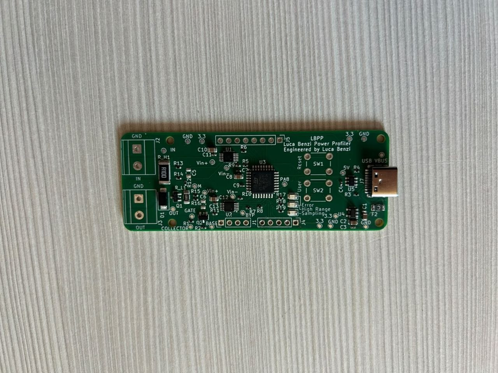
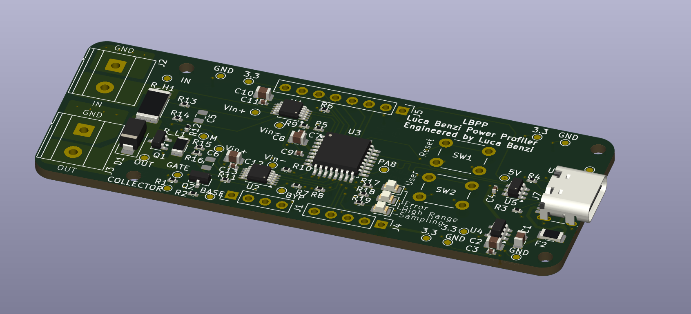
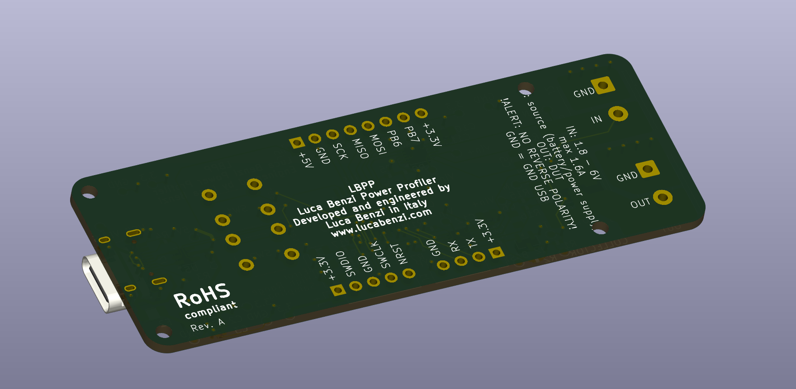
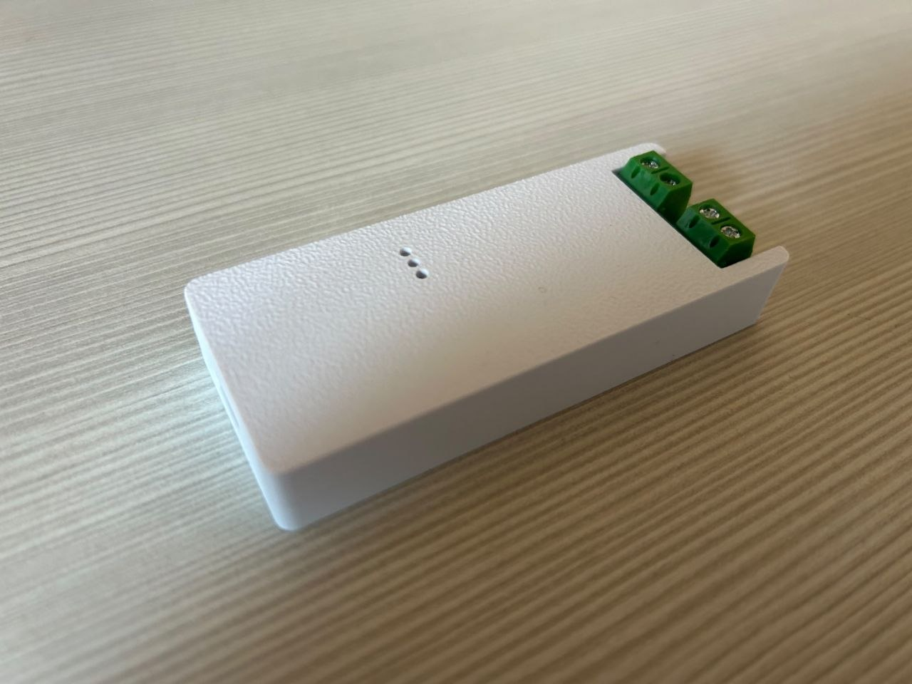
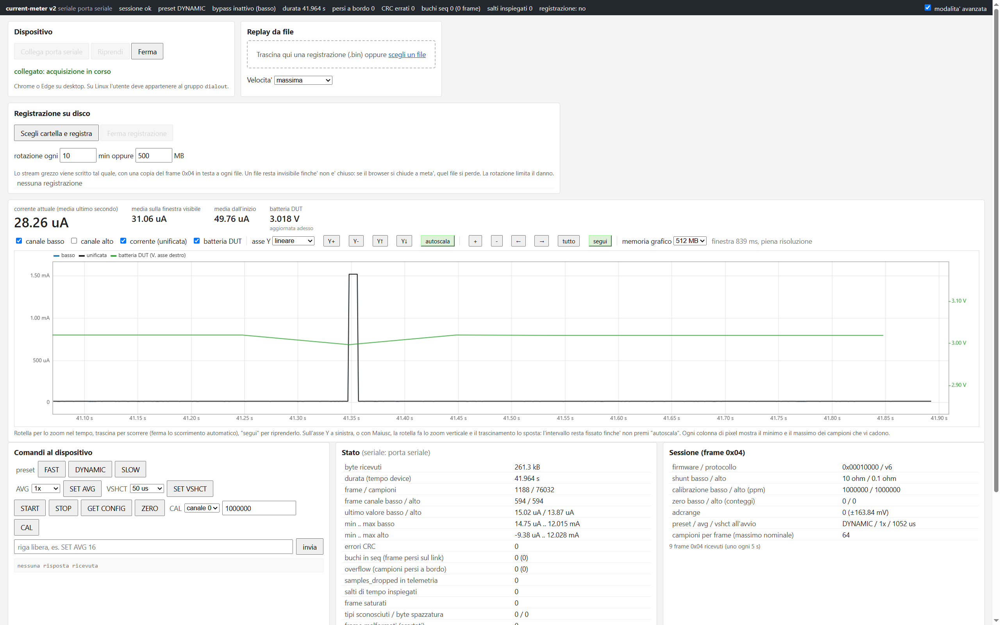
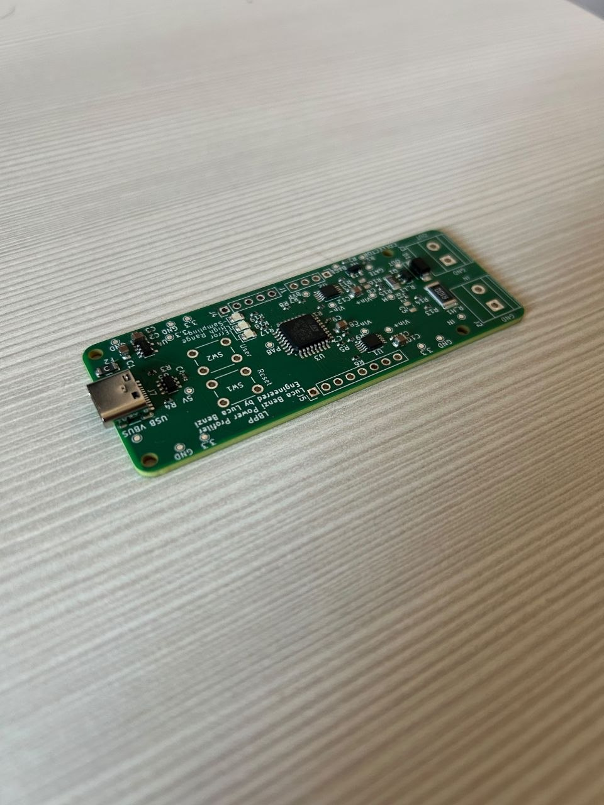

# LBPP, Luca Benzi Power Profiler

USB power profiler for battery powered devices. It measures from microamps to over an amp on the same instrument, with automatic range switching, and streams the data to a web application that runs in the browser.

## What it is for

Measuring the current drawn by a device that runs on a battery is awkward, because the interesting values span five orders of magnitude. A smartwatch sleeps at a few microamps and then wakes up for a few milliseconds at tens of milliamps. A multimeter either resolves the sleep current or survives the peak, not both, and switching range mid measurement loses exactly the part that matters.

LBPP solves this with two measurement paths that run at the same time, so no sample is lost while the range changes.

Typical use: estimating real battery life, finding the firmware routine that keeps a device awake, comparing two versions of the same firmware.

## How it works

| | |
|---|---|
| Current sensing | Two INA228, 20 bit delta sigma, one per range |
| Low range | 10 ohm shunt, full scale 16.384 mA, 31 nA per count |
| High range | 0.1 ohm shunt, full scale 1.6384 A |
| Range switching | P channel MOSFET that shorts the low range shunt, controlled by firmware |
| Sample rate | up to 20 kSps per channel (50 us conversion), down to 3.8 Sps in the slow preset |
| Input range | 1.8 V to 6 V, 1.6 A max |
| MCU | STM32G0B1, USB full speed, CDC |
| Host software | web application, Web Serial, no installation, no backend |
| PCB | 80 x 30 mm, 4 layers, 1.6 mm, lead free HASL |

Both INA228 read the bus voltage from the input side of the shunts, so the voltage reported is the DUT battery voltage without the burden of the measurement itself.

  
  

The bottom silkscreen carries the full pinout of the debug and expansion headers and the input limits, so the board can be used without opening this page.

The board lives in a 3D printed enclosure that leaves the screw terminals accessible and shows the three status LEDs through small holes in the lid.

The device to host protocol is a documented binary frame format, version 0.6. Every recording carries its own session header with shunt values, calibration and offsets, so a file recorded today stays readable after the instrument is recalibrated.

## Measured performance

- Sleep current measured on a smartwatch: 8.2 uA

## Web application

The host software runs in the browser at **[lucabenzi.com/current-meter](https://www.lucabenzi.com/current-meter/)**. It uses the Web Serial API, so it works in Chrome and Edge on desktop. There is nothing to install and no server involved: the data never leaves the machine.

It shows the live current trace with min/max decimation, the DUT battery voltage, time weighted averages, and it records sessions to file for later replay.

*A real trace: a device sleeping at about 28 uA wakes up for a few milliseconds at 1.5 mA, while its battery sits at 3.02 V. The window is 0.8 s wide at full resolution. The user interface is in Italian for now.*

## Manufactured by PCBWay

The boards were made and assembled by [PCBWay](https://www.pcbway.com/). Two assembled units plus the spare bare PCBs of the production panel.

**Disclosure:** PCBWay sponsored this build. They covered most of the cost in exchange for an honest review, and I paid the remainder myself. They did not see this text before publication and asked for no changes.

### How it went

**Quoting and BOM.** The assembly quote is handled by a person, not by a web form, so every revision of the design meant a new quotation by email. This is slower than the fully automated flow of other vendors, and it took several exchanges before procurement started. On the other hand it allowed a real conversation about the parts: when the fuse I had chosen turned out to be out of stock, their sales engineer proposed an equivalent resettable PTC and waited for my confirmation instead of substituting silently.

**Component sourcing.** Parts were bought from Western distributors against my BOM, with the exact manufacturer part numbers I specified. I asked explicitly that the two measurement shunts, a 0.1% low TCR 10 ohm and a 1% 0.1 ohm, must not be substituted with wider tolerance parts, and that request was respected. They also honoured the DNP list and the parts I supplied myself.

**Verification before production.** This is the part I liked most. Before completing the assembly they sent high resolution photos of one populated board, with the through hole parts tacked but not fully soldered, so anything wrong could still be changed. I could verify from the photos the diode orientation, the two SOT-23 transistors that are adjacent and easy to swap, the shunt values and the unpopulated pads. They also sent the CAM working file of the PCB for approval, where I checked the layer order of the four layer stackup.

**Quality of the result.** Solder joints are clean and regular, no bridges, no misaligned or tombstoned parts, and the fine pitch packages, an LQFP-32 and two VSSOP-10, are properly seated. The bare PCB itself is good: crisp silkscreen down to the small text, clean routed edges and holes, uniform finish. Two cosmetic defects: leftover solder on two pads that were meant to stay empty, with some unwashed flux around them, and a sticker left over the holes of a connector. Both are a minute of work with solder wick and isopropyl alcohol.

**Fine features.** The layout is not aggressive, but it is not relaxed either. Signal tracks are 0.2 mm, and around the LQFP-32 and the two VSSOP-10 (0.5 mm pitch) they go down to 0.15 mm (6 mil) track width with 0.15 mm clearance, on more than 70 segments. The 82 vias are 0.6 mm with a 0.3 mm drill, which leaves a 0.15 mm annular ring. Stackup is four layers, 1 oz copper on all of them, with solid ground and power planes on the inner layers. All of this came out exactly as drawn: no opens, no shorts, no mask slivers or misregistration on the fine pitch pads. No problems of any kind.

**Timing.** Order placed on 30 September. The bare PCBs were finished in a few days, the components arrived on 25 October, assembly photos on 10 November. The long part is sourcing, not manufacturing, and it includes the Chinese October holiday. Plan for about six weeks from order to delivery when parts have to be bought for you, and much less if you only order bare boards.

**Shipping and customs.** Worth knowing if you order from the EU: at checkout, choose DHL under the DDP section, listed as DHL (DTP). Duty and VAT are prepaid with the order and the parcel is not held at customs, which also avoids the courier handling fee. The other options either collect at delivery or prepay VAT only.

### Would I use them again

For an assembled prototype where I need someone to source specific parts and to check with me before soldering, yes. The human in the loop is worth the slower quoting. For plain bare boards, or for a batch where every part comes from their own library, a fully automated vendor is faster and cheaper.

## Repository layout

- `docs/protocol.md` device to host protocol specification, version 0.6 (in Italian)
- `docs/img/` photos

Firmware, KiCad design files and the web application source are not published.

## License

The contents of this repository, documentation, protocol specification and images, are released under [CC BY 4.0](https://creativecommons.org/licenses/by/4.0/). See [LICENSE](LICENSE).

---

Designed and built by Luca Benzi, Mantova, Italy. [lucabenzi.com](https://www.lucabenzi.com/)